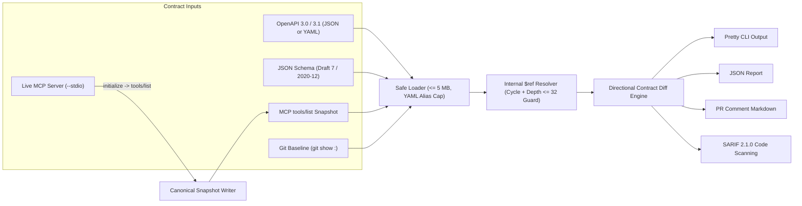

# @pie527645-cloud/schema-guard

Breaking change detector and deterministic contract snapshot diff CLI for **OpenAPI 3.0 / 3.1**, **JSON Schema (Draft 7 / 2020-12)**, and **Model Context Protocol (MCP) `tools/list`** contracts.

`schema-guard` automatically detects contract formats, resolves internal `#/...` `$ref` pointers with cycle and recursion-depth guards, classifies schema drift into `BREAKING`, `DANGEROUS`, and `NON_BREAKING` changes, captures canonical snapshots from live stdio MCP servers, and emits human-readable, Markdown, JSON, or **SARIF 2.1.0** reports for CI/CD pull request gates.

---

## Architecture



---

## Installation & Build from Source

Requires **Node.js >= 20.18.1**.

```bash
git clone https://github.com/pie527645-cloud/schema-guard.git
cd schema-guard
npm install
npm run build
node dist/cli.js --help
```

Optional local symlink for interactive shell usage:

```bash
npm link
schema-guard --version
```

---

## CLI Usage

### 1. Compare Two Contract Files (`diff`)

```bash
node dist/cli.js diff ./baseline/openapi.yaml ./candidate/openapi.yaml \
  --format pretty \
  --fail-on breaking
```

Supported `--format` options:
- `pretty` (default): structured terminal report
- `json`: machine-readable diff summary and change list
- `markdown`: pull-request summary table
- `sarif`: OASIS **SARIF 2.1.0** document compatible with GitHub Code Scanning

Supported `--fail-on` thresholds:
- `breaking` (default): exits `1` when one or more `BREAKING` changes are found
- `dangerous`: exits `1` when `BREAKING` or `DANGEROUS` changes are found
- `none`: always exits `0` when specifications parse cleanly

### 2. Capture Deterministic Live MCP `tools/list` Snapshot (`snapshot`)

Spawns an MCP server over stdio (`shell: false`), performs the `initialize` -> `notifications/initialized` -> `tools/list` JSON-RPC 2.0 handshake (including `nextCursor` pagination), cleanly terminates the server process tree, and writes a lexicographically sorted JSON snapshot:

```bash
node dist/cli.js snapshot \
  --stdio "node ./my-mcp-server/dist/index.js" \
  --out ./contracts/mcp-tools.snapshot.json \
  --timeout 15000
```

### 3. Diff Tracked Contract Against a Git Revision (`git-diff`)

Compares the working-tree version of a specification against any safe Git revision (`HEAD`, `origin/main`, tag, or commit SHA) without shell interpolation:

```bash
node dist/cli.js git-diff \
  --file contracts/mcp-tools.snapshot.json \
  --base origin/main \
  --repo . \
  --format markdown \
  --fail-on breaking
```

### Exit Codes

| Exit Code | Meaning |
| --- | --- |
| `0` | Contract check passed (no changes at or above `--fail-on` threshold) or snapshot saved |
| `1` | Contract check failed (`BREAKING` or `DANGEROUS` changes met `--fail-on` threshold) |
| `2` | Invalid CLI usage, unreadable file, oversized spec (`> 5 MB`), circular `$ref`, or parse failure |

---

## Classification Rules

| Severity | Examples |
| --- | --- |
| `BREAKING` | Removed MCP tool or OpenAPI path/HTTP method; added required property or parameter without `default`; removed property; incompatible or narrowed request type (`string` -> `integer`, removed `oneOf`/`anyOf` variant); removed `enum` value; tightened request/schema bounds (`maxLength` decreased, `minLength` increased, `maximum` decreased, `minimum` increased, `maxItems` decreased, `minItems` increased); `additionalProperties` restricted from open/`true` to `false`. |
| `DANGEROUS` | Added optional field without `default`; changed `default` or `format`; added `enum` value in response schema (may break exhaustive client switches); loosened numeric/string validation in response schema; marked active endpoint, tool, parameter, or field `deprecated: true`. |
| `NON_BREAKING` | Added new MCP tool or OpenAPI path/operation; added optional request field or parameter with `default`; widened request bounds (`maxLength` increased, `minimum` decreased); added request `enum` value; updated `description` or `summary` text. |

---

## GitHub Pull Request Workflow Example

Add `.github/workflows/contract-guard.yml` to block accidental breaking changes on pull requests and upload SARIF 2.1.0 findings:

```yaml
name: Contract Guard

permissions:
  contents: read
  security-events: write

on:
  pull_request:
    branches: [main]

jobs:
  schema-diff:
    runs-on: ubuntu-latest
    steps:
      - name: Checkout PR branch with full history
        uses: actions/checkout@v4
        with:
          fetch-depth: 0

      - name: Setup Node.js
        uses: actions/setup-node@v4
        with:
          node-version: '20.x'

      - name: Build schema-guard from source
        run: |
          git clone https://github.com/pie527645-cloud/schema-guard.git .schema-guard
          npm --prefix .schema-guard ci
          npm --prefix .schema-guard run build

      - name: Run contract diff and emit SARIF 2.1.0
        id: guard
        continue-on-error: true
        run: |
          node .schema-guard/dist/cli.js git-diff \
            --file openapi.yaml \
            --base origin/${{ github.base_ref }} \
            --format sarif \
            --fail-on breaking > schema-guard.sarif

      - name: Upload SARIF to GitHub Code Scanning
        if: always()
        uses: github/codeql-action/upload-sarif@v3
        with:
          sarif_file: schema-guard.sarif

      - name: Enforce breaking-change gate
        if: steps.guard.outcome == 'failure'
        run: exit 1
```

---

## Programmatic TypeScript / ESM API

```ts
import {
  captureMcpSnapshot,
  diffContents,
  diffFiles,
  formatSarif
} from '@pie527645-cloud/schema-guard';

const report = diffFiles('./v1/openapi.yaml', './v2/openapi.yaml');
if (report.hasBreaking) {
  process.stderr.write(formatSarif(report));
}

const snapshot = await captureMcpSnapshot({
  stdioCommand: 'node ./server.js',
  outPath: './mcp.snapshot.json',
  timeoutMs: 10_000
});
console.log(`Captured ${snapshot.tools.length} MCP tools.`);
```

---

## Security & Reliability Hardening

- **Bounded inputs:** Rejects specifications and subprocess streams exceeding `5 MB`.
- **YAML bomb defense:** Caps YAML alias expansion (`maxAliasCount: 50`).
- **Cycle & depth protection:** Detects circular `#/...` `$ref` chains and enforces maximum schema traversal depth (`<= 32`).
- **Prototype-pollution immunity:** Tracks schema properties, rules, and pointers in `Object.create(null)` dictionaries guarded with `Object.hasOwn`.
- **Subprocess safety:** Spawns `git` and `--stdio` MCP processes with `shell: false`, blocks leading-dash `--base` flag injection and `..` path traversal, and reaps descendant process trees cleanly on both Windows and Linux.

---

## Development

```bash
npm run lint
npm run build
npm test
```

## License

MIT
